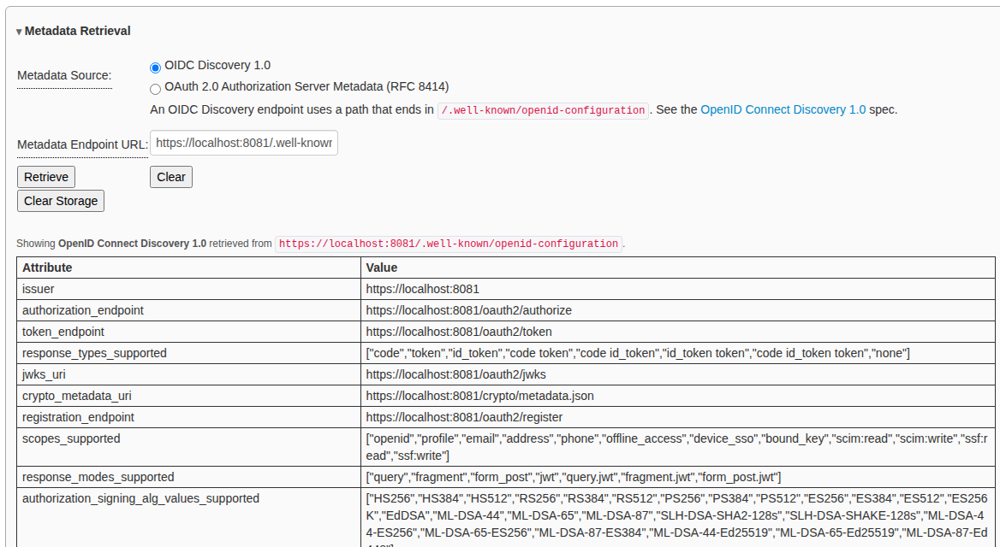
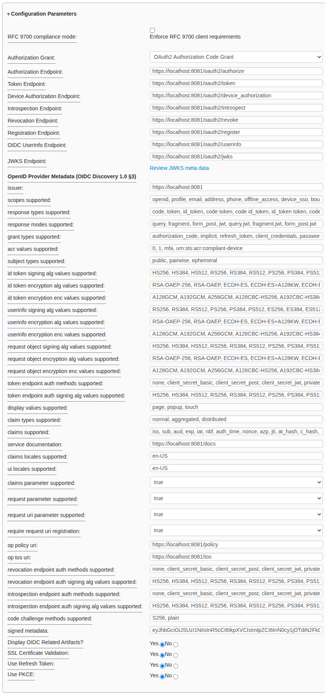

# Using the OAuth2 / OIDC workflow

The OAuth2 / OIDC workflow lets you run every OAuth 2.0 authorization grant
and every OpenID Connect authentication flow against a real authorization
server, one step at a time. At each step you see the request before it is sent
and the response after it comes back.

These pages show how to use it:

* **[OAuth 2.0 authorization grants](oauth2-grants.md)**: Authorization Code
  (with and without PKCE), Implicit, Resource Owner Password Credentials,
  Client Credentials, Device Authorization, Refresh Token, and Token Exchange.
* **[OpenID Connect authentication flows](oidc-flows.md)**: the Authorization
  Code flow, both Implicit flows, all three Hybrid flows, and DPoP-bound
  tokens.

This page covers the parts every grant and flow have in common. Read it first.

**The screenshots come from the test suite.** Each one was taken by the
Selenium job that drives that grant or flow (see
[Regenerating the screenshots](#regenerating-the-screenshots)). The
authorization server in them is the project's mock STS
([`rcbj/iya-sts`](https://rcbj.github.io/iya-sts/)), running at
`https://localhost:8081`. It is the same server the test suite uses, and it
signs anybody in with any password, so you can repeat every step here exactly.
To follow along against your own identity provider, use its discovery URL,
client IDs and secrets in place of the ones shown.

* TOC
{:toc}

## Before you start

### Start the debugger

From a checkout, follow *Getting Started* in the repository's
[README](../../README.md#getting-started). In short:

```bash
git submodule update --init --recursive
./generate-tls-cert.sh
CONFIG_FILE=./env/local.js docker-compose up
```

Then open `https://localhost:3000` and pick the **OAuth2 / OIDC** card. You can
also use the deployed copy at [idptools.com](https://idptools.com). It has no
back end, so token requests must be sent from the browser (see
[Front end or back end](#front-end-or-back-end)).

### Register a client at your identity provider

The debugger is a **client**. Your identity provider must know about it first.
Register a client with:

| Setting | Value |
|---|---|
| Redirect URI | `https://localhost:3000/callback` (or your debugger's address + `/callback`) |
| Grant types / response types | the ones you plan to test |
| Client type | *public* (no secret) for browser-style tests, *confidential* (with a secret) for server-style tests |
| Web origins / CORS | the debugger's origin, if token requests will be sent from the browser |

For the mock STS, see
[Configuring OAuth 2.0 grants](https://rcbj.github.io/iya-sts/configure-oauth2-grants.html)
and
[Configuring OpenID Connect flows](https://rcbj.github.io/iya-sts/configure-oidc-flows.html).
In development mode it accepts a client it has never seen. The Device
Authorization grant is the exception: that client must be registered first.

## How the workflow is laid out

The workflow is two pages.

| Page | What you do there |
|---|---|
| **Step 1** (`oauth2_oidc_1.html`) | Load the provider's metadata, choose a grant or flow, and send the **authorization request** (or the device authorization request). |
| **Step 2** (`oauth2_oidc_2.html`) | See what the authorization endpoint returned, send the **token request**, and work with the tokens: refresh, introspect, revoke, exchange, call UserInfo, or log out. |

Grants that have no authorization request (Client Credentials and Resource
Owner Password Credentials) take you straight to step 2 when you choose them.

Every section of both pages is a pane you can collapse or expand by clicking
its title. The pages remember which panes you had open.

## Step 1: load the provider's metadata

Every grant and flow starts the same way. In **Metadata Retrieval**:

1. Choose the **Metadata Source**:
   * **OIDC Discovery 1.0** for a URL ending in
     `/.well-known/openid-configuration`.
   * **OAuth 2.0 Authorization Server Metadata (RFC 8414)** for a URL ending
     in `/.well-known/oauth-authorization-server`.
2. Enter the **Metadata Endpoint URL**, for example
   `https://localhost:8081/.well-known/openid-configuration`.
3. Click **Retrieve**. The document is shown as a table, one row per member.
4. Click **Populate Meta Data** below the table. This copies the endpoints
   and the advertised capabilities into the Configuration Parameters pane.



If you have no metadata document, skip this step and type the endpoints into
the Configuration Parameters pane yourself.

## Step 1: check the configuration

The **Configuration Parameters** pane holds the settings shared by every
request:



| Field | What it does |
|---|---|
| **RFC 9700 compliance mode** | Makes the debugger refuse to send anything the OAuth 2.0 Security Best Current Practice forbids. Off by default, so you can test providers that do not comply. See [RFC 9700 compliance mode](../rfc9700.md). |
| **Authorization Grant** | Chooses the grant or flow. The rest of both pages changes to match it. |
| **Endpoints** | Authorization, token, introspection, revocation, registration, UserInfo and JWKS. Filled in by **Populate Meta Data**. |
| **Provider metadata** | The rest of the discovery document, for reference. |
| **Display OIDC Related Artifacts?** | Shows or hides the ID token, nonce and UserInfo controls. |
| **SSL Certificate Validation** | Set to **No** when the provider uses a self-signed certificate and token requests go through the back end. |
| **Use Refresh Token** | Shows the refresh pane on step 2. |
| **Use PKCE** | Adds a PKCE `code_challenge` (RFC 7636) to the authorization request and the `code_verifier` to the token request. |

## Step 2: send the token request

Each grant has a token request pane on step 2. Its title depends on the grant,
for example *Exchange Authorization Code for Access Token*. These fields work
the same way in every grant:

| Field | What it does |
|---|---|
| **Client ID / Client Secret** | The client's credentials. Leave the secret empty for a public client. |
| **Auth Style** | **POST** sends `client_id` and `client_secret` in the form body (`client_secret_post`). **Header** sends them as HTTP Basic authentication (`client_secret_basic`). |
| **Initiate Token Endpoint Call From front or backend** | See [Front end or back end](#front-end-or-back-end). |
| **DPoP (RFC 9449)** | Binds the access token to a key held by the page. See [DPoP](oidc-flows.md#sender-constrained-tokens-with-dpop). |
| **Add Resource field?** | Adds an RFC 8707 `resource` parameter. |
| **Custom query parameters** | Adds parameters the provider needs that the form does not have a field for. |
| **Request** | The exact request that **Get Token** will send. It updates as you type. |

Every pane that sends a request has two tabs. **Parameters** is the form.
**HTTP** shows the request and response exactly as they were exchanged, with
headers and timing, once the call has been made. The tab title shows the
status code, for example **HTTP · 200**.

### Front end or back end

A token request can be sent two ways:

* **Front**: the browser calls the token endpoint directly. The provider must
  allow the debugger's origin with CORS, or the browser blocks the call. When
  that happens the result shows `status: 0`, which means the request never
  reached the provider; it does not mean the provider refused it. A DPoP proof
  can only be sent this way.
* **Back**: the debugger's API service (`https://localhost:4000`) sends the
  request from the server, so CORS does not apply. Use this when the provider
  does not allow the debugger's origin. The deployed static sites have no API
  service, so this option is disabled there.

## Step 2: read the results

Results appear in panes below the token request:

| Pane | What it shows |
|---|---|
| **Authorization Endpoint Results** | Tokens that came back on the redirect from the authorization endpoint. Only the Implicit and Hybrid flows return tokens there. |
| **Token Endpoint Results** | The most recent tokens from the token endpoint. |
| **Token Endpoint Results for Refresh Token Call** | The tokens from the most recent refresh, shown beside the originals so you can compare them. |
| **Token History** | Every set of tokens this page has obtained. Click one to show it in **Currently Viewing**. |

Each token comes with buttons and links:

* **The token's name** (for example *Access Token*) opens the token detail
  page. It decodes the JWT, explains each claim using the IANA registry, and
  lets you verify the signature with a shared secret, a certificate or the
  provider's JWKS.
* **Introspect Token** sends it to the introspection endpoint (RFC 7662).
* **Get UserInfo Data** calls the UserInfo endpoint with the access token.
* **Revoke Token** sends it to the revocation endpoint (RFC 7009).
* **Copy Token** copies it to the clipboard.

## After the flow

Further down step 2 are panes that work with the tokens you now hold:

* **RP-initiated Logout**: ends the session at the provider (OpenID Connect
  RP-Initiated Logout 1.0).
* **Token Revocation (RFC 7009)**: revokes any token you paste in.
* **Token Exchange (RFC 8693)**: exchanges a token for a different one. See
  [Token Exchange](oauth2-grants.md#token-exchange-rfc-8693).

## What the debugger remembers

Everything you type is saved in the browser's `localStorage`, so the forms are
filled in again next time. **Passwords are never saved.** To start over, click
**Clear Storage** in the Metadata Retrieval pane or clear the site data for
the debugger in your browser.

## Regenerating the screenshots

The screenshots are taken by the test jobs that drive these screens. The
helper that takes them, `tests/doc_screenshots.js`, does nothing unless
`DOC_SCREENSHOT_DIR` is set. To regenerate them, start the stack, then run each
job with that variable set:

```bash
cd tests
DOC_SCREENSHOT_DIR=../docs/oauth2-oidc/images \
  CONFIG_FILE=./env/local.js \
  OIDC_FLOW=oidc_hybrid_code_id_token OIDC_DPOP=off \
  node oidc_flows.js -u https://localhost:3000
```

Each run writes `<grant-or-flow>-<step>.png`, and overwrites the previous copy.

| Job | Pictures |
|---|---|
| `oauth2_authorization_code.js` | `oauth2-authorization-code-*` |
| `oauth2_implicit.js` | `oauth2-implicit-*` |
| `oauth2_resource_owner_password_credentials_grant.js` | `oauth2-password-*` |
| `oauth2_client_credentials.js` | `oauth2-client-credentials-*` |
| `oauth2_device_authorization.js` | `oauth2-device-authorization-*` |
| `oauth2_auth_style.js` | `oauth2-refresh-token-*` |
| `oauth2_token_exchange.js` | `oauth2-token-exchange-*` |
| `oidc_flows.js` (once per `OIDC_FLOW`, and with `OIDC_DPOP=on`) | `oidc-*` |

The pictures here were taken against the mock STS, using the environment each
job's entry in `tests/run-report.js` describes. Three details affect what is
captured:

* `oidc_flows.js` signs in **with consent on** (the mock's default), which is
  how `oidc-authorization-code-05-consent.png` was taken. The four jobs that
  use the shared helpers in `common/tests.js` were written for Keycloak, which
  shows no consent screen. Run them with the mock's `oauth2.consentRequired`
  set to `false`.
* The Device Authorization job needs `oauth2.deviceAuthorization` set to
  `true` and its client registered in the mock first.
* The `oauth2_*` jobs check Keycloak-specific claims (such as `azp`) after the
  last screenshot. Against the mock those checks fail, but all the screens have
  already been captured.
