# OAuth 2.0 authorization grants

This page shows how to run each OAuth 2.0 grant the debugger supports. For
each grant it covers when to use it, the steps on each page, and what you
should see.

The steps shared by every grant are on
[Using the OAuth2 / OIDC workflow](index.md): loading the provider's metadata,
the configuration pane, the token request fields, and the results panes. Read
that page first. The OpenID Connect flows, which add an ID token to these
grants, are on [OpenID Connect authentication flows](oidc-flows.md).

* TOC
{:toc}

## Which grants are supported

| Grant | `grant_type` sent to the token endpoint | Use it for | Choose in **Authorization Grant** |
|---|---|---|---|
| [Authorization Code](#authorization-code) | `authorization_code` | a person signing in to a web, mobile or single-page app | *OAuth2 Authorization Code Grant* |
| [Implicit](#implicit) | none (the token comes back on the redirect) | legacy browser apps only | *OAuth2 Implicit Grant* |
| [Resource Owner Password Credentials](#resource-owner-password-credentials) | `password` | legacy first-party apps only | *OAuth2 Resource Owner Password Credential Grant* |
| [Client Credentials](#client-credentials) | `client_credentials` | a service acting for itself, with no person involved | *OAuth2 Client Credential* |
| [Device Authorization](#device-authorization-rfc-8628) | `urn:ietf:params:oauth:grant-type:device_code` | a TV, console or command-line tool with no browser of its own | *OAuth2 Device Authorization Grant* |
| [Refresh Token](#refresh-token) | `refresh_token` | getting new tokens without signing in again | the refresh pane on step 2, after any grant that returned a refresh token |
| [Token Exchange](#token-exchange-rfc-8693) | `urn:ietf:params:oauth:grant-type:token-exchange` | trading one token for another, for example to call a downstream API | the Token Exchange pane on step 2 |

**RFC 9700**, the OAuth 2.0 Security Best Current Practice, says the Implicit
and Resource Owner Password Credentials grants must not be used. The debugger
supports them so that you can test the providers that still do. If you turn on
**RFC 9700 compliance mode** in the configuration pane, the **Authorization
Grant** list disables both of them.

## Authorization Code

A person signs in at the provider. The provider sends an authorization code
back to the debugger's redirect URI, and the debugger exchanges that code for
tokens at the token endpoint. This is the grant to use for any application
with a person behind it.

**PKCE** (RFC 7636) protects the code from being stolen and used by someone
else. Use it with every client. Public clients, which have no secret, must use
it.

### Steps

**Step 1 page**

1. Load the provider's metadata, as described in
   [Step 1: load the provider's metadata](index.md#step-1-load-the-providers-metadata).
2. In **Configuration Parameters**, set **Authorization Grant** to
   *OAuth2 Authorization Code Grant* and **Use PKCE** to **Yes**.

   

3. In **Request Authorization Code**, enter:
   * **Client ID**: the client registered at the provider.
   * **Redirect URL**: `https://localhost:3000/callback`.
   * **Scope**: the scopes the client needs, separated by spaces.

   The **State** and **Nonce** are generated for you, and so are the PKCE
   **code_challenge**, **code_verifier** and **code_method** (`S256`).
   **Request** shows the URL that **Authorize** will open.

   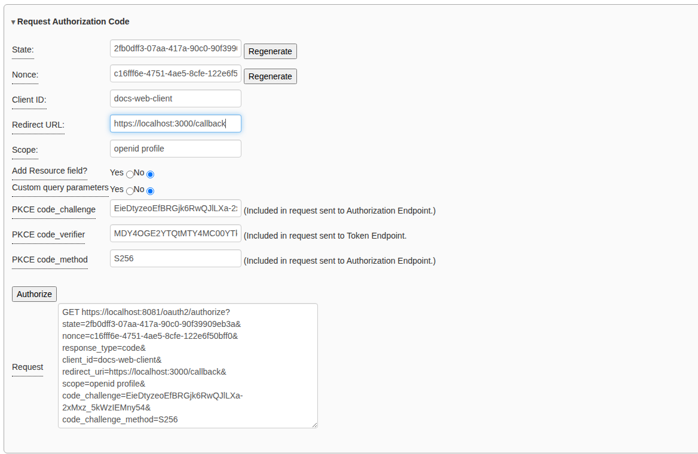

4. Click **Authorize**. The browser goes to the provider.

**At the provider**

5. Sign in. With the mock STS any username works and the password is not
   checked. The username you type becomes the token's subject.

   

6. If the provider asks you to allow access, click **Allow**. The browser
   returns to the debugger's step 2 page, with the code already in the
   **Authorization Code** field.

**Step 2 page**

7. In **Exchange Authorization Code for Access Token**, check the
   **Client ID** and **Redirect URL**. The redirect URL must match the one
   sent in step 3 exactly. For a confidential client, also enter the
   **Client Secret** and choose an **Auth Style**.
8. Click **Get Token**.

   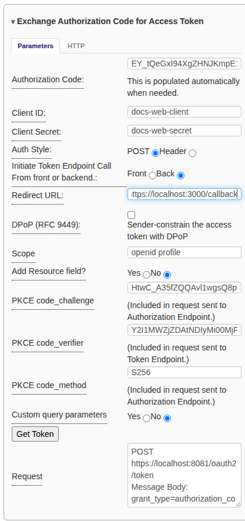

### What you should see

**Token Endpoint Results** shows the access token. It also shows a refresh
token if the provider issued one, and an ID token if you asked for the
`openid` scope.

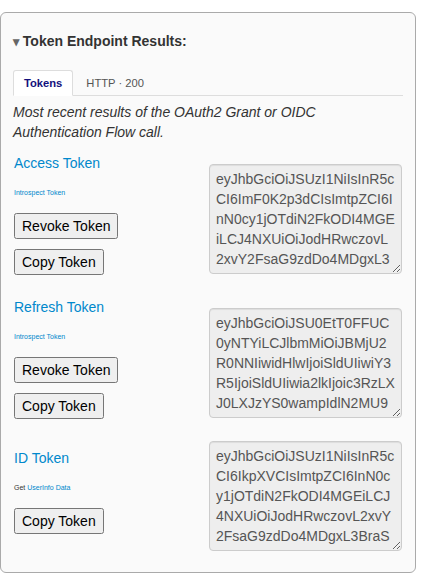

### If it goes wrong

* **The provider shows an error instead of a sign-in page**: the client ID or
  redirect URI does not match what is registered. The error is in the URL the
  browser returned to, and in the **Authorization Endpoint Results** pane.
* **`invalid_grant` from the token endpoint**: the code has expired (they
  usually last a few minutes), was already used, or the redirect URL differs
  from the one in the authorization request.
* **`status: 0`**: the request never left the browser. See
  [Front end or back end](index.md#front-end-or-back-end).

## Implicit

The provider returns the access token directly on the redirect, in the URL
fragment, and there is no token request. The token can leak through browser
history and logs, and it cannot be sender-constrained, so this grant is only
for testing older applications.

### Steps

1. Load the provider's metadata.
2. Set **Authorization Grant** to *OAuth2 Implicit Grant*.
3. In **Request Access Token**, enter the **Client ID**, **Redirect URL** and
   **Scope**, then click **Authorize**. The request carries
   `response_type=token`.

   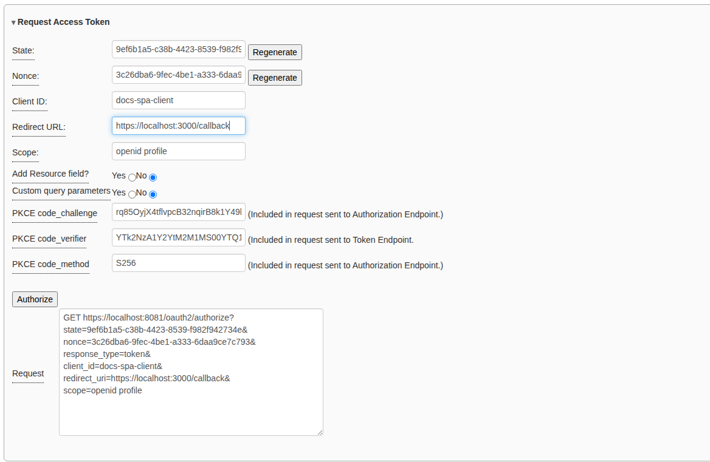

4. Sign in at the provider (and allow access if asked).

### What you should see

The step 2 page opens with the access token in **Authorization Endpoint
Results**, because the token came from the authorization endpoint and not the
token endpoint. There is no refresh token.

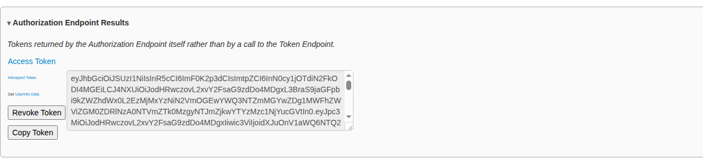

## Resource Owner Password Credentials

The client collects the person's username and password and sends them to the
token endpoint itself. The person never sees the provider's sign-in page, so
none of the provider's own protections (multi-factor authentication, for
example) can apply. Use it only to test a provider that still allows it.

### Steps

1. Load the provider's metadata.
2. Set **Authorization Grant** to
   *OAuth2 Resource Owner Password Credential Grant*. The debugger goes
   straight to the step 2 page, because this grant has no authorization
   request.
3. In **Obtain Access Token**, enter the **Client ID**, the **Client Secret**
   (for a confidential client), the **Scope**, and the person's **Username**
   and **Password**.
4. Click **Get Token**.

   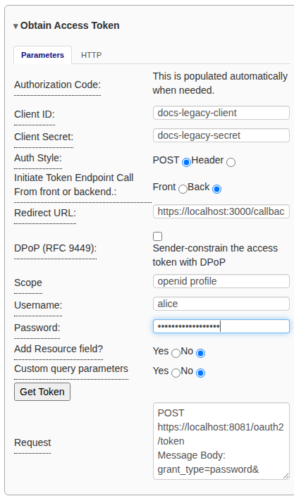

The password is used for this one request and is never saved.

### What you should see

**Token Endpoint Results** shows the access token, and usually a refresh token.
If you asked for `openid`, it also shows an ID token.

## Client Credentials

The client authenticates as itself and gets a token for its own use. No
person signs in, so no refresh token or ID token is issued. Use it for
service-to-service calls.

### Steps

1. Load the provider's metadata.
2. Set **Authorization Grant** to *OAuth2 Client Credential*. The debugger
   goes straight to the step 2 page.
3. In the token request pane, enter the **Client ID**, **Client Secret** and
   **Scope**. Choose the **Auth Style** your provider expects: **POST** for
   `client_secret_post` or **Header** for `client_secret_basic`.
4. Click **Get Token**.

   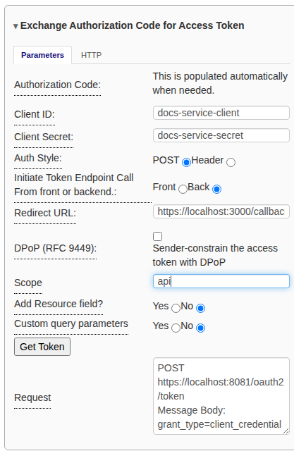

### What you should see

**Token Endpoint Results** shows a single access token. Its subject is the
client itself.

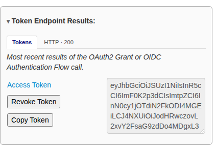

### If it goes wrong

* **`invalid_client`**: the secret is wrong, or the provider expects the other
  **Auth Style**.
* **`unauthorized_client`**: the client is not allowed this grant, or it is a
  public client. A public client cannot use Client Credentials.
* **`invalid_scope`**: the client is not allowed one of the scopes you asked
  for.

## Device Authorization (RFC 8628)

For a device that cannot show a browser, such as a TV or a command-line tool.
The device asks the provider for a short **user code**. The person enters that
code on another device (usually a phone) and approves the request, and the
device then collects the tokens. The debugger plays the part of the device.

### Steps

**Step 1 page: ask for a user code**

1. Load the provider's metadata. It must include a
   `device_authorization_endpoint`.
2. Set **Authorization Grant** to *OAuth2 Device Authorization Grant*.
3. In **Request Device Authorization**, enter the **Client ID** and **Scope**,
   then click **Authorize**. This sends a `POST` to the device authorization
   endpoint; the browser does not leave the debugger.

   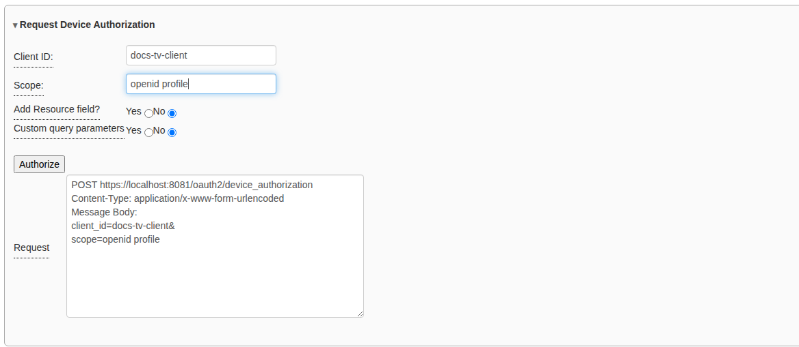

**Step 2 page: the codes**

4. The step 2 page shows the provider's answer: the **User Code**, the
   **Verification URI** (and the complete version with the code included) and
   the **Device Code**. Copy the verification URI.

   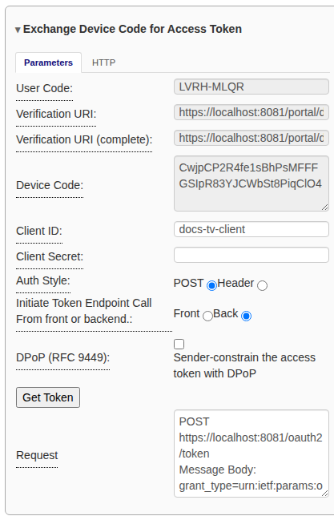

**On the "other device": approve**

5. Open the verification URI in a browser (any tab, or another device). Sign
   in.

   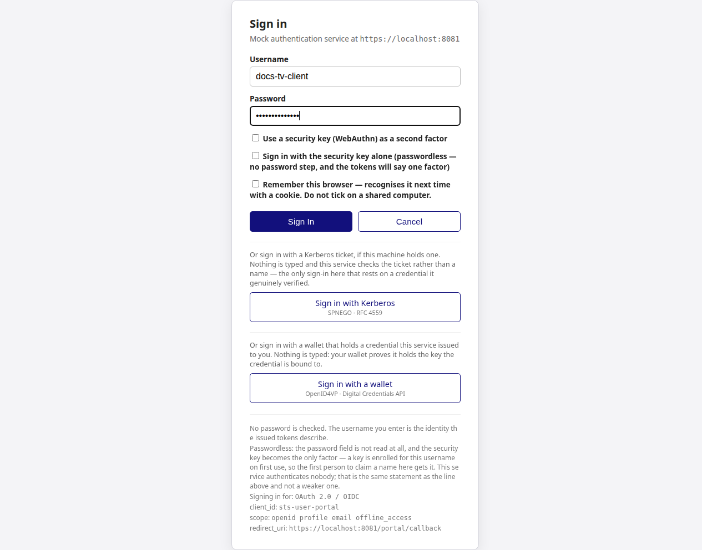

6. Enter the user code and click **Continue**. (With the complete
   verification URI the code is already filled in.)

   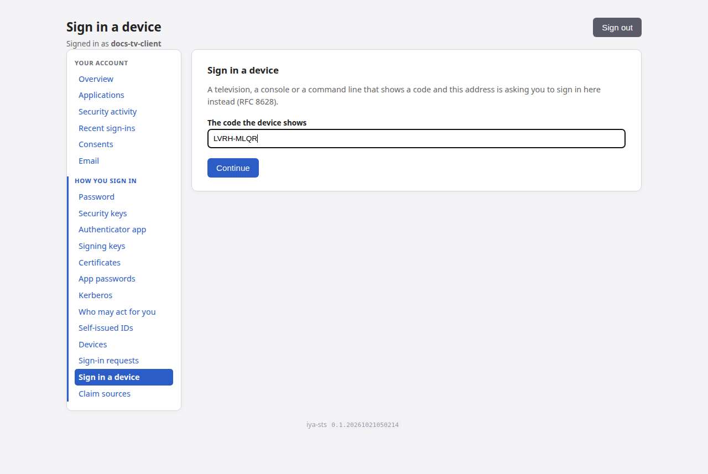

7. Check that the code matches the one the debugger shows, then click
   **Approve**.

   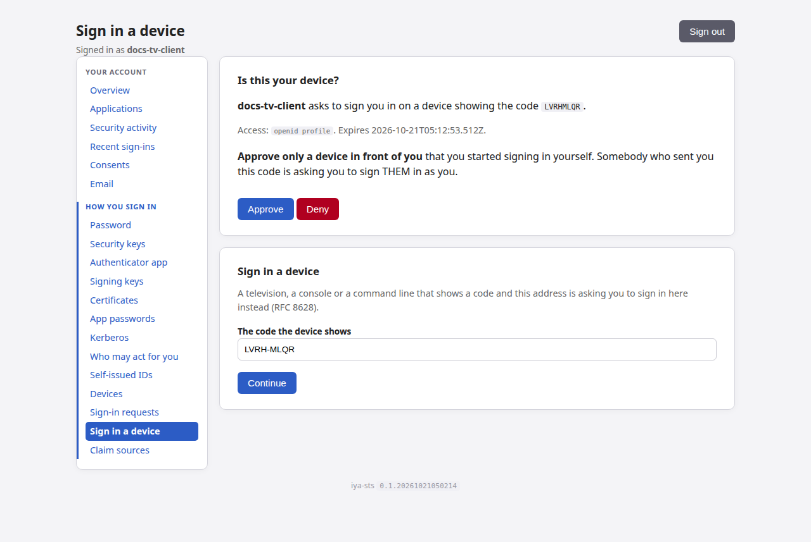

**Step 2 page: collect the tokens**

8. Go back to the debugger's step 2 page. The device code is still filled in.
   Click **Get Token**.

### What you should see

**Token Endpoint Results** shows the access token (and a refresh token and ID
token, if the scope asked for them).

If you click **Get Token** before approving, the provider answers
`authorization_pending`. That is the expected answer while the person has not
yet decided: approve the request, then click **Get Token** again. A real
device polls the token endpoint until it gets a different answer. The other
answers are `slow_down` (poll less often), `access_denied` (the person clicked
**Deny**) and `expired_token` (start again from step 3).

## Refresh Token

A refresh token gets a new access token without asking the person to sign in
again. The debugger keeps the refresh token from the last token response and
fills it in for you.

**Refreshing needs a refresh token.** Most providers issue one only to an
Authorization Code, Device Authorization or Password grant, and only when you
ask for the `offline_access` scope or the client is configured for it.

### Steps

1. Run a grant that returns a refresh token. The example below uses the
   Authorization Code grant with a confidential client, sending its secret
   with **Auth Style** set to **Header**.

   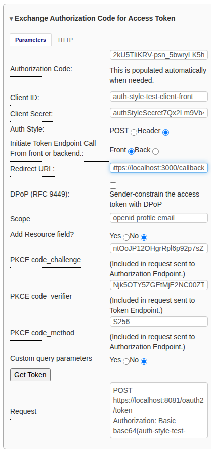

2. Make sure **Use Refresh Token** is **Yes** in the configuration pane.
3. Scroll to **Obtain New Access Token Using Refresh Token**. The
   **Refresh Token** and **Client ID** are filled in already. Enter the
   **Client Secret** for a confidential client, and choose the same
   **Auth Style** as before.
4. Optionally change the **Scope**. You can ask for fewer scopes than the
   original grant, but not more.
5. Click **Get Token**.

   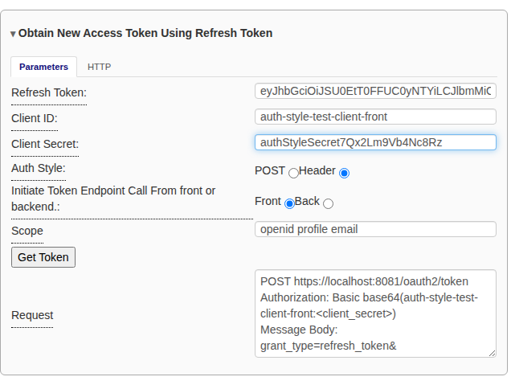

### What you should see

**Token Endpoint Results for Refresh Token Call** appears next to the original
results, so you can compare the two sets. It shows the new access token, and a
new refresh token if the provider *rotates* refresh tokens (RFC 9700 says
public clients must). **iteration** counts the refreshes made since the
original token response, starting at 0.

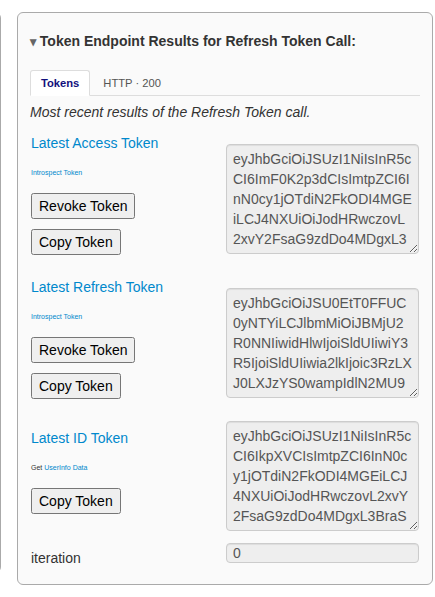

Click **Get Token** again to refresh again. When refresh tokens rotate, the
old one stops working once it has been used; if the provider detects it being
used a second time, it may revoke the whole family of tokens.

## Token Exchange (RFC 8693)

Token Exchange trades a token you hold (the *subject token*) for a new one,
usually for a different audience. A typical use is an API that receives a
user's token and needs a token to call another API on that user's behalf.

### Steps

1. Run any grant that gives you an access token. The example uses the
   Authorization Code grant.
2. Scroll to **Token Exchange (RFC 8693)** on step 2. The **Subject Token** is
   filled in with your latest access token.
3. Choose the **Exchange Type**:
   * **Impersonation**: the client acts as the subject, and the new token is
     simply about that subject.
   * **Delegation**: someone else (the *actor*) acts on the subject's behalf.
     **Actor Token** and **Actor Token Type** fields appear; paste the actor's
     token there. Providers usually record the actor in an `act` claim.
4. Set the **Subject Token Type** and **Requested Token Type**
   (`access_token` for both in most cases).
5. Enter the target in **Audience** (a client ID or logical name) and/or
   **Resource** (a URL), and optionally a narrower **Scope**.
6. Enter the **Client ID** and **Client Secret** of the client making the
   exchange, choose an **Auth Style**, and click **Exchange Token**.

   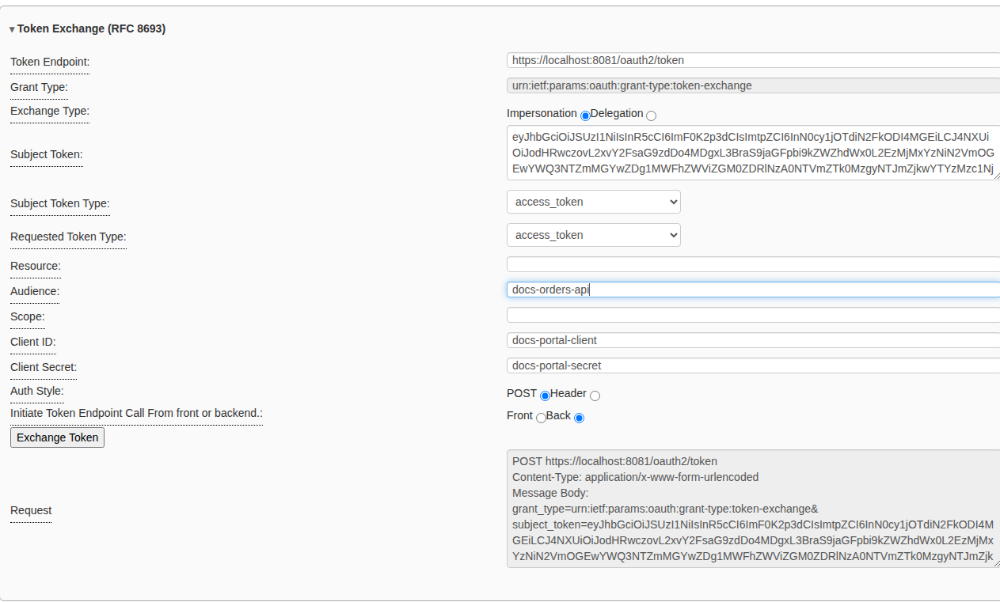

### What you should see

**Token Exchange Results** shows the HTTP status and the response body. The
response holds the new `access_token`, its `issued_token_type`, and its
`token_type`. The **HTTP** tab shows the exchange as it went over the wire,
and **Tokens** shows the new token with the usual buttons.

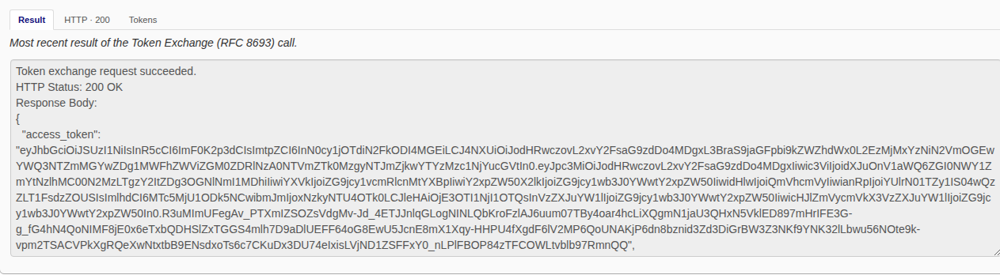

The most common refusal is `invalid_target`: the client is not allowed to ask
for that audience. Providers usually need the exchange to be permitted for the
pair of clients involved.

## Related

* [Using the OAuth2 / OIDC workflow](index.md): the common steps and panes.
* [OpenID Connect authentication flows](oidc-flows.md): ID tokens, nonces,
  and the Hybrid flows.
* [RFC 9700 compliance mode](../rfc9700.md): what the debugger checks when
  compliance mode is on.
* The mock STS's [Configuring OAuth 2.0 grants](https://rcbj.github.io/iya-sts/configure-oauth2-grants.html):
  how to set up the other side.
