# OpenID Connect authentication flows

This page shows how to run each of the six OpenID Connect authentication flows
the debugger supports, and how to make the access token sender-constrained
with DPoP.

OpenID Connect is a sign-in layer on top of OAuth 2.0. Its flows are OAuth 2.0
authorization requests that ask for the `openid` scope, and they return an
**ID token**: a signed statement from the provider about who signed in, and
when. The flows differ only in which artifacts come back from the
authorization endpoint (on the browser redirect) and which come from the token
endpoint (on a server-to-server call).

The steps shared by every flow (loading the metadata, the configuration pane,
the token request fields and the results panes) are on
[Using the OAuth2 / OIDC workflow](index.md). The OAuth 2.0 grants, including
Refresh Token and Token Exchange, are on
[OAuth 2.0 authorization grants](oauth2-grants.md).

* TOC
{:toc}

## Which flows are supported

Each flow is named after the `response_type` it sends:

| Flow | `response_type` | From the authorization endpoint | From the token endpoint | Choose in **Authorization Grant** |
|---|---|---|---|---|
| [Authorization Code](#authorization-code-flow) | `code` | code | access token, ID token (and refresh token) | *OIDC Authorization Code Flow(code)* |
| [Implicit](#implicit-flow-id_token-token) | `id_token token` | ID token, access token | (no token request) | *OIDC Implicit Flow(id_token token)* |
| [Implicit, ID token only](#implicit-flow-id_token) | `id_token` | ID token | (no token request) | *OIDC Implicit Flow(id_token)* |
| [Hybrid](#hybrid-flow-code-id_token) | `code id_token` | code, ID token | access token, ID token | *OIDC Hybrid(code id_token)* |
| [Hybrid](#hybrid-flow-code-token) | `code token` | code, access token | access token, ID token | *OIDC Hybrid(code token)* |
| [Hybrid](#hybrid-flow-code-id_token-token) | `code id_token token` | code, ID token, access token | access token, ID token | *OIDC Hybrid(code id_token token)* |

Use the **Authorization Code flow** unless you are testing something that
needs one of the others. Anything returned on the redirect travels in the URL
fragment, where browser history, extensions and logs can see it. RFC 9700
advises against returning access tokens that way and against the Implicit
flow altogether. If you turn on **RFC 9700 compliance mode**, the
**Authorization Grant** list disables both Implicit flows and the two Hybrid
flows that return an access token (`code token` and `code id_token token`).

## Three things every flow has in common

* **Include `openid` in the scope.** Without it the provider treats the
  request as plain OAuth 2.0 and returns no ID token. `profile` and `email`
  add the corresponding claims.
* **A nonce is sent on every request.** The **Nonce** field is generated for
  you, and the provider must copy it into every ID token it issues for that
  request. Open the ID token's detail page (click **ID Token** in the results)
  to compare its `nonce` claim with the one you sent. A mismatch means the
  token was not issued for this request.
* **The ID token is for the client, not for APIs.** Its audience (`aud`) is
  your client ID. To call an API, use the access token.

## Authorization Code flow

The provider returns only a code on the redirect. The debugger exchanges it at
the token endpoint for an access token and an ID token. No token passes
through the browser's address bar.

### Steps

**Step 1 page**

1. Load the provider's metadata, as described in
   [Step 1: load the provider's metadata](index.md#step-1-load-the-providers-metadata).
2. Set **Authorization Grant** to *OIDC Authorization Code Flow(code)*, and
   leave **Use PKCE** at **Yes**.
3. In **Request Authorization Code**, enter the **Client ID**, the
   **Redirect URL** (`https://localhost:3000/callback`) and a **Scope** that
   includes `openid`. Check that **Request** shows `response_type=code` and a
   `nonce`.

   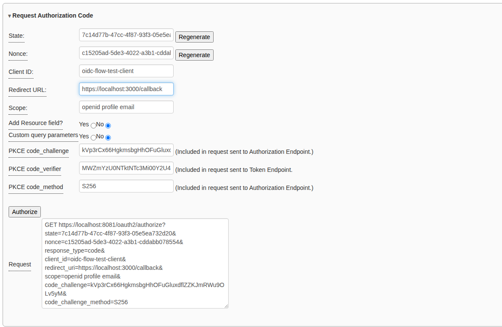

4. Click **Authorize**.

**At the provider**

5. Sign in.
6. The first time a person signs in to a client, many providers ask them to
   approve the scopes. Click **Allow**. (**Deny** sends the error
   `access_denied` back to the debugger.)

   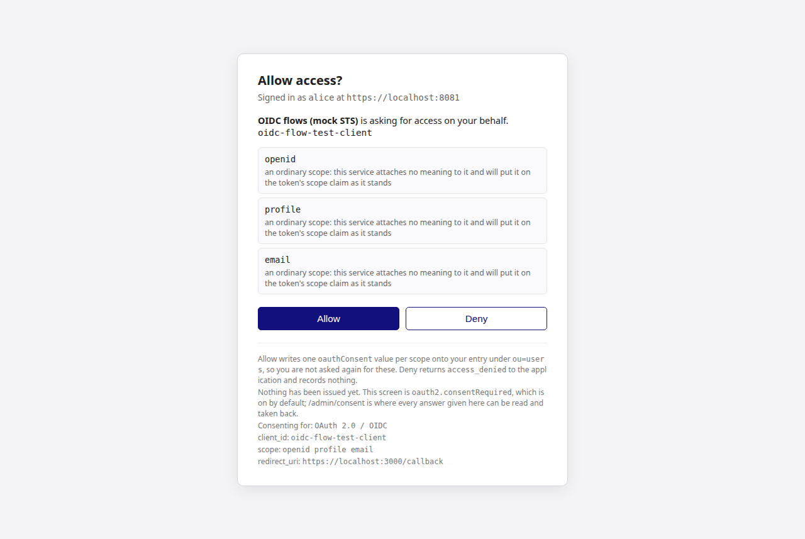

**Step 2 page**

7. The code is already in **Exchange Authorization Code for Access Token**.
   Check the **Client ID** and **Redirect URL**, add the **Client Secret** for
   a confidential client, and click **Get Token**.

   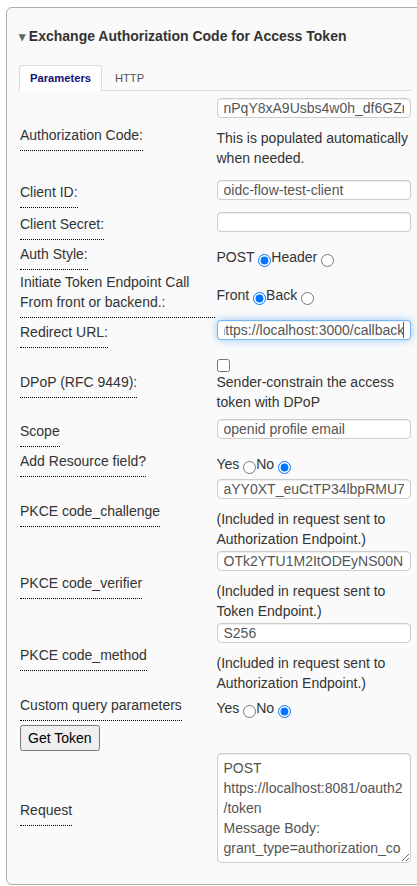

### What you should see

**Token Endpoint Results** shows the access token, the ID token, and a refresh
token if the provider issued one. **Get UserInfo Data** under the ID token
calls the UserInfo endpoint with the access token, which returns the profile
claims the scopes asked for.

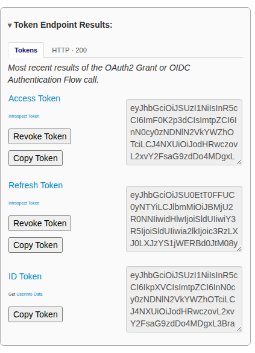

## Implicit flow (`id_token token`)

The provider returns the ID token and an access token directly on the
redirect, and there is no token request. This flow is for testing older
single-page applications.

### Steps

1. Load the provider's metadata.
2. Set **Authorization Grant** to *OIDC Implicit Flow(id_token token)*.
3. In **Request Access Token**, enter the **Client ID**, **Redirect URL** and a
   **Scope** with `openid`. **Request** shows `response_type=id_token token`
   and a nonce. The nonce is required for the Implicit and Hybrid flows.

   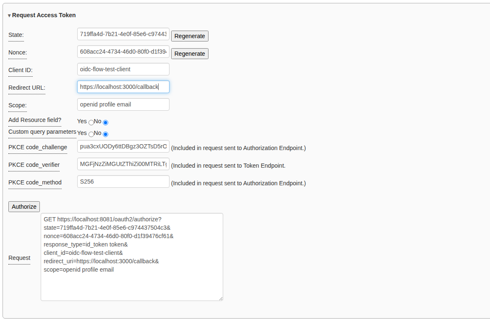

4. Click **Authorize**, then sign in (and allow access if asked).

### What you should see

The step 2 page opens with both tokens in **Authorization Endpoint Results**.
There is no refresh token, because refresh tokens only come from the token
endpoint.

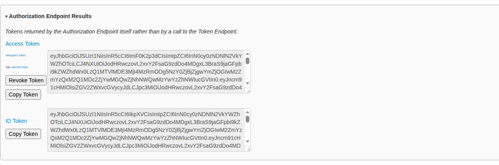

## Implicit flow (`id_token`)

Only an ID token comes back, on the redirect. Use it when the client only
needs to know who the person is and will not call any API.

### Steps

The same as the [Implicit flow above](#implicit-flow-id_token-token), with
**Authorization Grant** set to *OIDC Implicit Flow(id_token)*.

### What you should see

**Authorization Endpoint Results** shows only the ID token. The pane explains
that there is no **Get UserInfo Data** link: UserInfo needs an access token,
and this flow returned none.

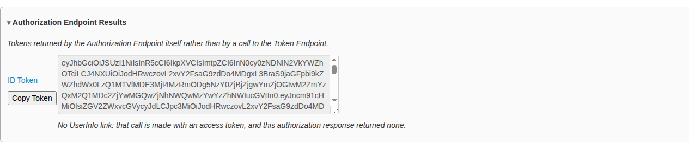

## The Hybrid flows

The Hybrid flows return a code **and** one or two tokens on the redirect. The
client can use the front-channel tokens straight away (for example, to show who
signed in), then exchange the code at the token endpoint for tokens it can
trust more. The steps are the same for all three; only the selected flow and
what comes back differ.

### Steps

1. Load the provider's metadata.
2. Set **Authorization Grant** to one of the three *OIDC Hybrid* options.
3. In **Request Authorization Code**, enter the **Client ID**, **Redirect URL**
   and a **Scope** with `openid`. Check the `response_type` in **Request**.
4. Click **Authorize**, then sign in (and allow access if asked).
5. On step 2, read the tokens in **Authorization Endpoint Results**.
6. The code is already in **Exchange Authorization Code for Access Token**.
   Click **Get Token** to exchange it.

The token endpoint returns a fresh access token and ID token. OpenID Connect
requires both ID tokens to have the same issuer (`iss`) and subject (`sub`).
Open each one's detail page to compare them.

### Hybrid flow (`code id_token`)

The redirect carries the code and an ID token. The ID token includes `c_hash`,
a hash of the code, which ties the two together.

### Hybrid flow (`code token`)

The redirect carries the code and an access token, and no ID token. The ID
token comes only from the token endpoint.

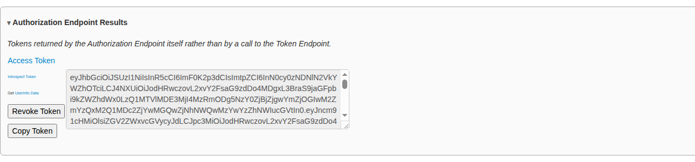

### Hybrid flow (`code id_token token`)

The redirect carries all three. The front-channel ID token includes both
`c_hash` (for the code) and `at_hash` (for the access token).

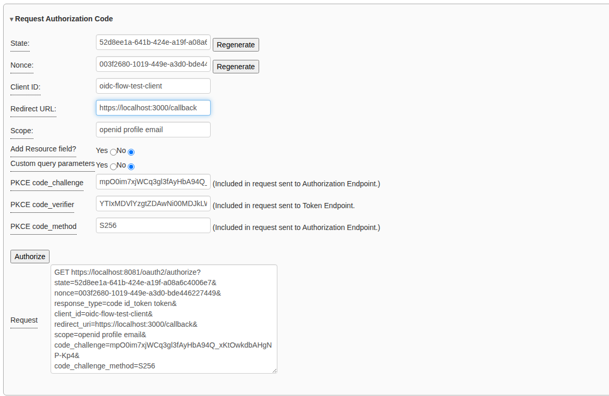

After **Get Token**, **Token Endpoint Results** shows the second set:

## Sender-constrained tokens with DPoP

An ordinary access token is a *bearer* token: whoever holds it can use it.
**DPoP** (RFC 9449) binds the token to a key pair that the debugger page holds.
Each request that uses the token must carry a fresh proof signed with that
key, so a stolen token is useless on its own.

DPoP is off by default. It works with every flow that has a token request (the
Authorization Code and Hybrid flows), and with the token-endpoint grants on
the [OAuth 2.0 page](oauth2-grants.md).

### Steps

1. Open the step 2 page (`https://localhost:3000/oauth2_oidc_2.html`) before
   you start the flow. In the token request pane, tick **DPoP (RFC 9449)**.
   A key pair is generated, and its thumbprint is shown as **jkt**. Click
   **Generate Key Pair** if you want a new one. Until a token has been
   requested, the pane says *No token has been requested with this key yet*.

   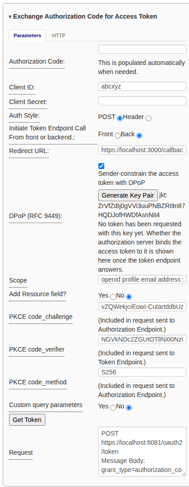

2. Go back to step 1 and run the flow as usual. With DPoP on, the
   authorization request also carries `dpop_jkt`, the key's thumbprint, which
   binds the code to the key as well.
3. On step 2, set **Initiate Token Endpoint Call** to **Front** before you
   click **Get Token**. The proof is made in the browser, so it can only be
   sent with a request the browser makes. The DPoP row confirms that the
   authorization request carried `dpop_jkt`, so the code is bound to the key.

   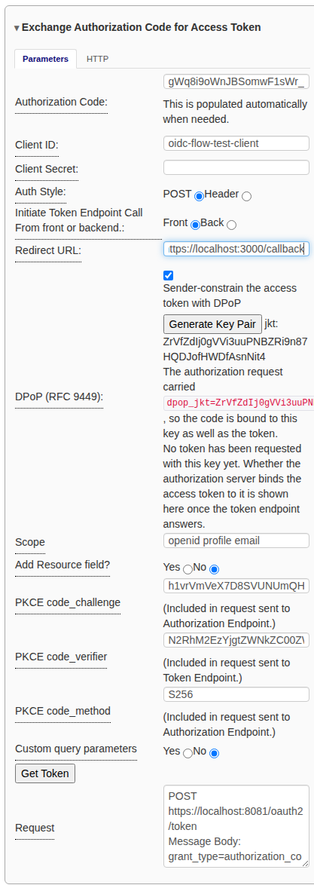

Turn DPoP on **before** the authorization request. If you generate a new key
after the code was issued, the provider will refuse to redeem the code, because
it is bound to the old key; start the flow again.

### What you should see

Below **Token Endpoint Results**, a line reports the binding. *The token is
sender-constrained: cnf.jkt = …* means the provider bound the token to this
page's key, and the token's `token_type` is `DPoP` rather than `Bearer`.

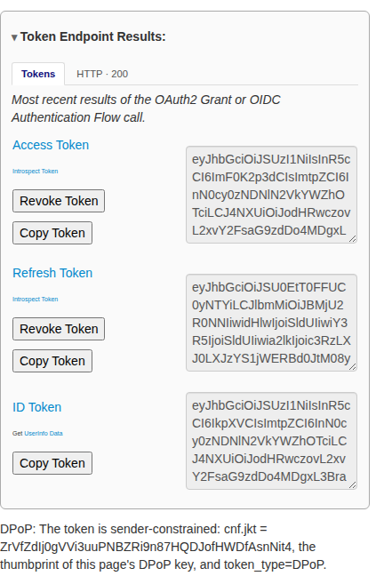

The two other results are problems with the provider, not with the debugger:

* *…came back with no cnf.jkt*: the provider ignored the DPoP proof and
  issued an ordinary Bearer token. Check that it advertises
  `dpop_signing_alg_values_supported` in its metadata. (Keycloak needs to be
  started with `--features=dpop`.)
* *…bound to …, which is NOT this page's key*: the provider bound the token to
  a different key.

With the two Implicit flows, DPoP has nothing to bind: their tokens come from
the authorization endpoint, which never sees a proof. The DPoP pane says so.

## Related

* [Using the OAuth2 / OIDC workflow](index.md): the common steps and panes.
* [OAuth 2.0 authorization grants](oauth2-grants.md): the underlying grants,
  plus Refresh Token and Token Exchange.
* [RFC 9700 compliance mode](../rfc9700.md).
* The mock STS's [Configuring OpenID Connect flows](https://rcbj.github.io/iya-sts/configure-oidc-flows.html):
  how to set up the other side.
